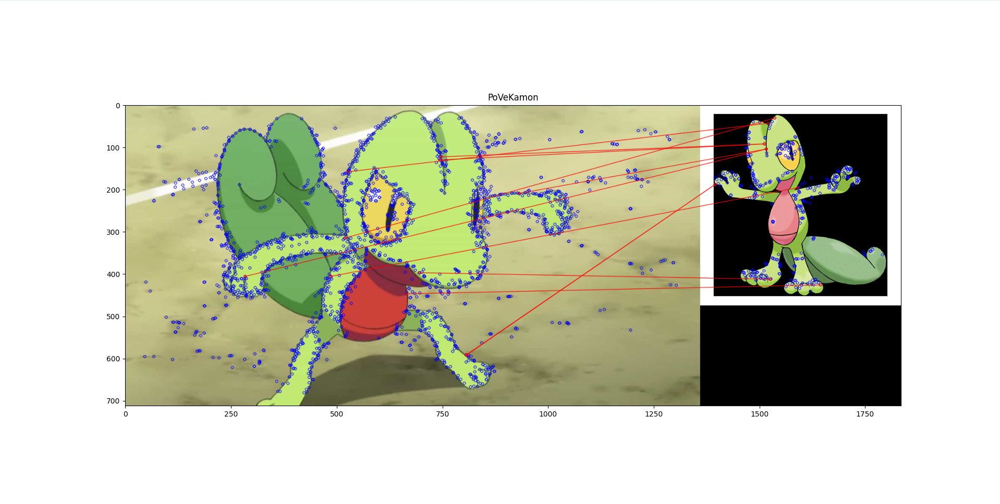
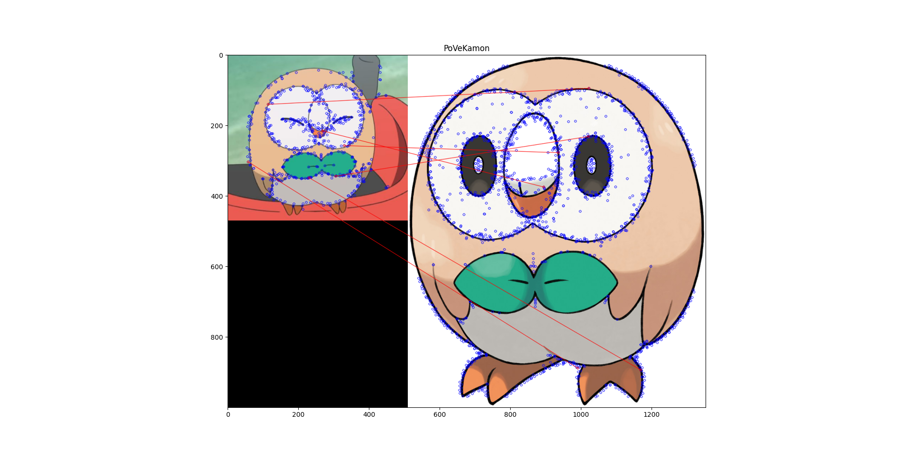

# PoVeKamon

Professor Oak wanted to expand the Podex by adding new object data. To ensure accuracy, he prepared a dataset containing the target object image and several reference images. After preprocessing them into grayscale and applying Gaussian Blur, he used the AKAZE algorithm for feature detection and FLANN with Lowe’s ratio test for matching. His goal was to identify and register the correct object automatically into the Podex.

## Dataset Description
- **Target Object Image**
  - Contains the image of the specific object to be identified.
- **Object Images (Data Folder)**
  - Includes images of all candidate objects used for comparison.

## Dataset Preprocessing
- All images are converted to **grayscale** and preprocessed using a **Median Blur** filter.
  - **Kernel Size: 3**

## Feature Detection
- Features are extracted from each image using the **AKAZE** feature detection algorithm.

## Feature Matching
- The features of the target object image are matched with each image using the **FLANN** (Fast Library for Approximate Nearest Neighbors) algorithm.
- Matching is evaluated based on **Lowe’s ratio test**, and the image with the best match is identified and displayed.

## Result Image

