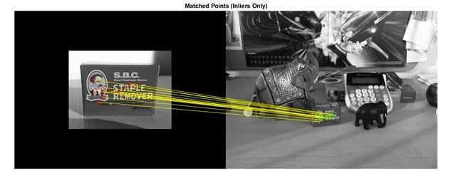
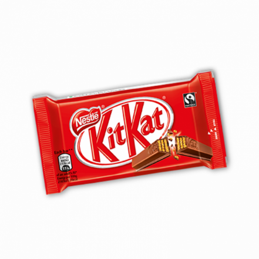
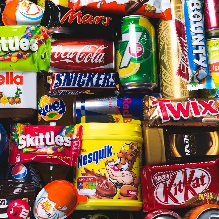
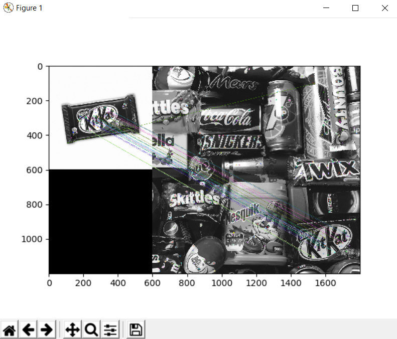

# Practicum Case: Image Matching

## Learning Outcomes

- Various computational principles and standard image processing operators in computer vision
- The local features with their detectors and descriptors in computer vision
- Various features to find correspondence between images and perform recognition in computer vision
- Various image recognition system in computer vision

## Topics

- Session 06 – Image Matching

## Subtopics

- Feature Descriptor
- Feature Matching

## Image Matching

Image matching is a task, simply a part of many computer vision applications that generally establishing correspondences between two images of the same scene/object. A common approach to image matching consists of detecting a set of interest points each associated with image descriptor from image data. From this course, we will create a program that will detect an object within the scene area. We will try to match Figure (2). in a scene in Figure (3).



*Figure 1. Example of image matching*



*Figure 2. Kitkat*



*Figure 3. Kitkat in scene*

1. **Preparing the library**

We will use 2 libraries for this course, which are .**cv2** (OpenCV library) and **pyplot** from **matplotlib** (python plotting library).

```python
import cv2
from matplotlib import pyplot as plt
```

*Figure 4. Importing library*

2. **Read images**

We will need a container for holding on the corresponding images that we read:

- The targeted image
- The scene image

**Note**: **The images were placed as the same folder level with the python script**

```python
kitkat = cv2.imread('kitkat.png')
kitkat_scene = cv2.imread('kitkat_scene.jpg')
```

*Figure 5. Read images*

3. **Convert images color**

In addition to the previous images we’ve read, each image should be in a colorful state (RGB). We would like to reduces that to a single grayscale state, since it helps reduce computational requirements and simplifies the algorithm. Simply, if we try to extract the interest point while in colorful state, it could introduce us to unnecessary information, which will then led to increased amount of training data required to give the same performance as when we try to extract the interest point while in grayscale state.

```python
kitkat_grayscale = cv2.cvtColor(kitkat, cv2.COLOR_RGB2GRAY)
kitkat_scene_grayscale = cv2.cvtColor(kitkat_scene, cv2.COLOR_RGB2GRAY)
```

*Figure 6. Converting images to grayscale*

4. **Creating feature detector and descriptor**

After we convert all images to grayscale, now’s the time to create our feature detector and descriptor to mark all of the interest points. Some well-known feature detectors like **SIFT** (**Scale-Invariant Feature Transform**), **SURF** (**Speeded-Up Robust Feature**), and **ORB** (**Oriented FAST and Rotated BRIEF**) are the most basic. For this course, we will use **SURF** feature detection as it is better in rotation invariant, blur, and warp transformation, not to mention that the scale of the targeted image and the image in the scene has scale which is more or less the same size. We would also like to configure the **Hessian Threshold**. What this does is determine how large the output from **Hessian** filter needed in order to be marked as an interest point. A larger value means fewer, but more salient interest points.

```python
surf = cv2.xfeatures2d.SURF_create()
surf.setHessianThreshold(15000)
```

*Figure 7. Creating SURF feature detector*

5. **Mark interest points and descriptors**

We already made the feature detection, now we can apply it to the targeted image and the scene image to determine its keypoints (interest point) and its descriptors. Using method from **cv2**, detect all features from targeted image and scene image without applying image mask.

```python
keypoint_kitkat,descriptor_kitkat = surf.detectAndCompute(kitkat_grayscale,None)
keypoint_kitkat_scene,descriptor_kitkat_scene = surf.detectAndCompute(kitkat_scene_grayscale,None)
```

*Figure 8. Detecting keypoints and descriptor*

6. **Create matcher**

Here we already have all of the features from the images, now we can create the matcher using **FLANN** (**Fast Library for Approximate Nearest Neighbors**) algorithm. **FLANN** algorithm itself needs a few arguments, which are what algorithm to use for matching and how many recursion needed for the match cycle to occur.

```python
KD_TREE = 0
INDEX_PARAMS = dict(algorithm=KD_TREE)
SEARCH_PARAMS = dict(checks=50)
Flann = cv2.FlannBasedMatcher(INDEX_PARAMS, SEARCH_PARAMS)
```

*Figure 9. Creating FLANN matcher*

7. **Match images and building image mask**

Match the targeted image’s feature with the scene image’s feature using the matcher, and then we can create a mask based on the match result. We will only change the value of mask when the distance of the first best match is less than the distance of the second-best match multiplied by a constant according to **Lowe**’s paper.

```python
matches = Flann.knnMatch(descriptor_kitkat,descriptor_kitkat_scene,k = 2)
valid_matches = []
for i in range(len(matches)):
    valid_matches.append([0,0])

for idx,(FB,SB) in enumerate(matches):
    if FB.distance < 0.7 * SB.distance:
        valid_matches[idx] = [1,0]
```

*Figure 10. Match image and taking best match*

8. **Draw matches and show result**

We are practically done, now we just need to draw those matches line and show the result using plotting library.

```python
img_res = cv2.drawMatchesKnn(
    kitkat_grayscale,
    keypoint_kitkat,
    kitkat_scene_grayscale,
    keypoint_kitkat_scene,
    matches,None,
    matchesMask = valid_matches
)

plt.imshow(img_res)
plt.show()
```

*Figure 11. Drawing matches line*

Result :



*Figure 12. Image result*

**References**:

- [https://nl.mathworks.com/products/computer-vision.html](https://nl.mathworks.com/products/computer-vision.html)
- [https://quickmartbd.com/wp-content/uploads/2018/09/Kit-Kat-3-Finger-Chocolate-270x320.jpg](https://quickmartbd.com/wp-content/uploads/2018/09/Kit-Kat-3-Finger-Chocolate-270x320.jpg)
- [https://images.theconversation.com/files/216793/original/file-20180430-135810-1udygqw.jpg?auto=format&fit=clip&ixlib=rb-1.1.0&q=45&w=1000](https://images.theconversation.com/files/216793/original/file-20180430-135810-1udygqw.jpg?auto=format&fit=clip&ixlib=rb-1.1.0&q=45&w=1000)
