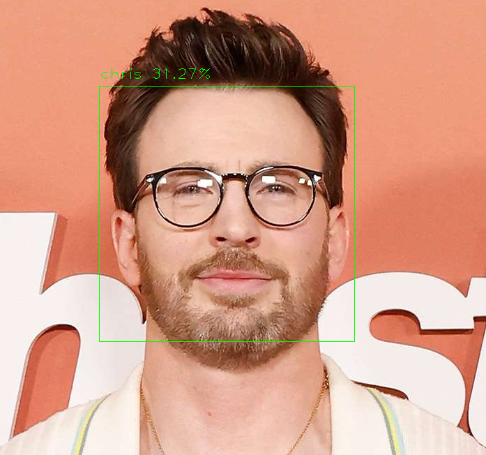

# Quiz Preparation: Face Recognition

## Dataset

- Train
- Test

## Main Program

1. Train and Test Model

Detect faces from the dataset and store the results in lists. Train the model using the training dataset, then make predictions on the test dataset and print the average accuracy of the correct predictions.

2. Predict

Use the saved model, if the model not declared yet, show error message. Provide user to input absolute path, then display the image result.

Example



```text
1. Train and test model.
2. Predict image.
Enter your choice: 2
Enter the path to the image for testing (Absolute Path): :D/images/test/chris/2.jpg
```
