# Computer Vision Mid Exam

Nama: REDACTED_NAME

**File Soal:** vision_engine_v1.ipynb

**File Jawaban:** vision_engine_v2.ipynb

- **Algorithmic Instability and Theoretical Comprehension**
  - **Identify and explain the mathematical or computational cause of each instability.**
      - Gaussian Smoothing

Kernel yang buggy menghitung ekspresi exp(-(x²+y²)/(2·σ)), bukan 2·σ², sehingga penyebaran Gaussian menggunakan σ (standar deviasi) bukan variance (σ²). Akibatnya, penyebaran menjadi terlalu sempir ketika σ > 1. Selain itu, langkah normalisasi kernel juga tidak ada, menyebabkan jumlah total nilainya tidak sama dengan 1. Ini menyebabkan proses convolution dapat memperkuat atau justru melemahkan intensitas tergantung pada nilai σ dan kernel size. Sehingga perbedaan kecil pada input dapat menghasilkan corner/edge maps yang sangat berbeda.

      - Canny Edge Detection

OpenCV mau input threshold1 < threshold2, tapi code buggy menukar mereka (threshold1=high, threshold2=low), jadi hysteresis menggunakan 150 sebagai “weak” cutoff dan 50 sebagai “strong” cutoff. Ini membuat pixel tidak pernah mencapai lower bound, sehingga tepi lemah tidak bisa terhubung ke tepi kuat. Hal ini menyebabkan ketidakstabilan hasil edge detection.

      - Harris Corner Detection

Nilai Harris direturn tanpa normalization, dan detector menggunakan fixed threshold bernilai 1e7 dan tidak ada non-maximum suppression. Ini menyebabkan corner detection menghasilkan banyak titik palsu (over-response) untuk yang cahaya terang, sebaliknya untuk yang gelap tidak mendeteksi sudut sama sekali.

      - RANSAC Homography

Code buggy mengkonfigurasi homography menggunakan 1-pixel reprojection tolerance dan cuma 100 iterations. Dalam feature matching, hasil deteksi biasanya mengandung banyak outlier. Konfigurasi ini bisa membuat semua pasangan titik dianggap tidak valid. Biasanya RANSAC sebaiknya menggunakan toleransi 3-5 pixel dan iteration antara 1000-2000 kali.

  - **Visualize the impact of incorrect parameters (e.g., corner count, edge noise).**
      - Gaussian Smoothing

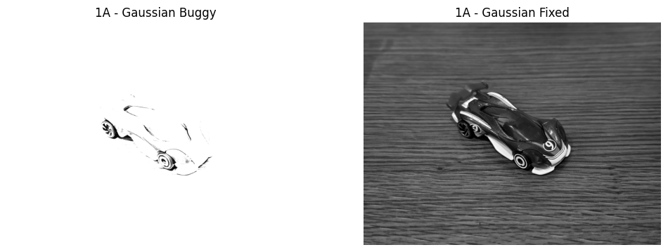

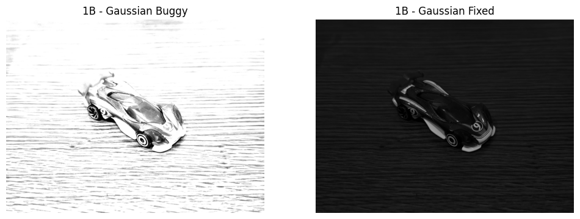

Plot 1A/1B – Gaussian Buggy vs Fixed memperlihatkan kernel salah menghasilkan smoothing yang tampak belang. Bagian terang gelap terkompres sehingga noise contrass tinggi tetap muncul, sedangkan untuk versi fixed menampilkan permukaan lebih halus. Ada juga heatmap kernel dalam code menunjukkan jumlah elemen tidak satu sehingga respon intensitas ikut berubah.

      - Canny Edge Detection

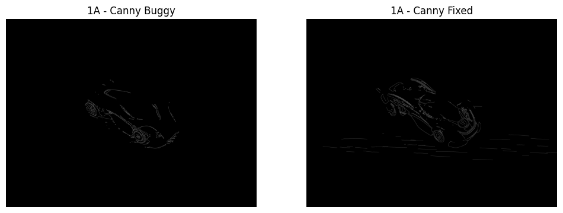

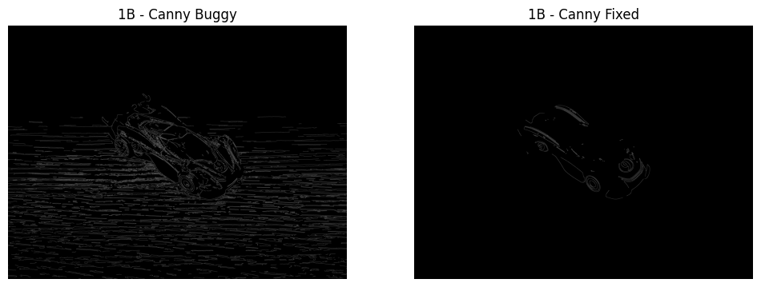

1A Canny Edge Counts: 24933 (Buggy) vs 45311 (Fixed)

1B Canny Edge Counts: 346481 (Buggy) vs 19283 (Fixed)

Pada code buggy, menunjukkan edge detection kosong atau hanya memunculkan titik acak karena threshold kuat lemah terbalik. Dibanding dengan versi fixed dimana memunculkan edge memang di tepi objek.

      - Harris Corners

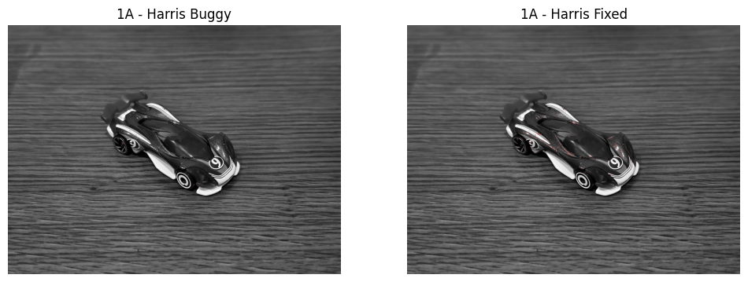

Buggy kpsA: 25 kpsB: 7

Fixed kpsA: 500 kpsB: 500

Gambar 1A – Harris Buggy vs Fixed menggambarkan bahwa buggy menghasilkan sangat sedikit atau tidak ada keypoint pada gambar. Versi fixed dengan normalisasi dan NMS menyebar sudut secara stabil (berwarna merah dot kecil, harus agak di zoom untuk bisa melihat dot merahnya).

      - RANSAC Homography

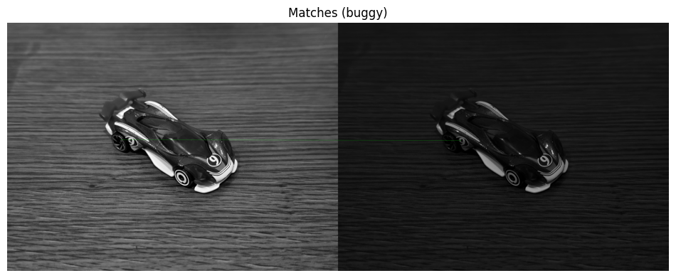

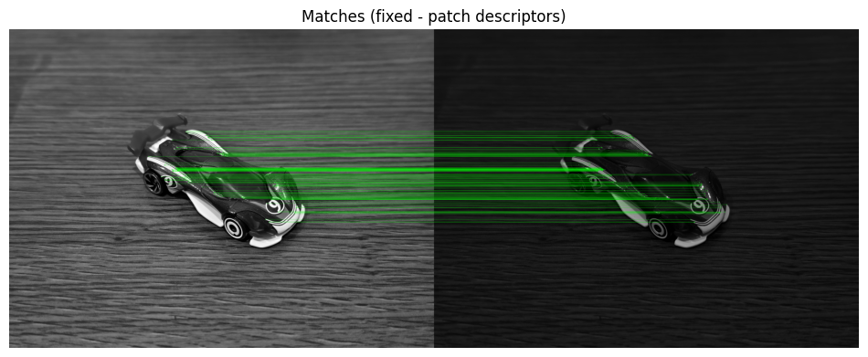

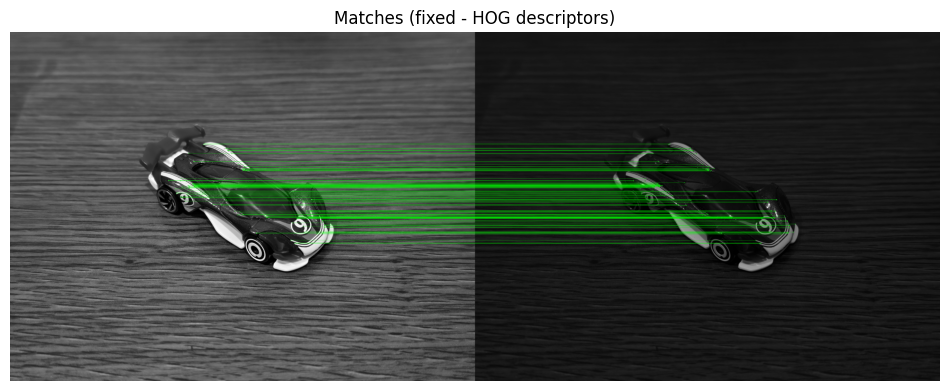

Diatas ini ada Matches untuk Pair pertama, dimana gambar teratas adalah gambar buggy hampir tidak ada garis hijau yang terlihat yang diakibatkan oleh threshold 1 dan 100 iterasi. Gambar fixed ada 2 karena menggunakan 2 descriptor, yang raw pixel dan HOG dan keduanya memberi Matches yang cukup signifikan.

  - **Propose and implement corrected versions, with quantitative comparison.**
      - Gaussian Smoothing

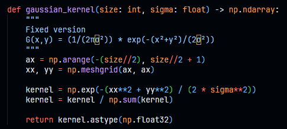

Kernel diperbaiki dengan memasukkan varians penuh pada eksponen dan normalisasi ∑K=1.

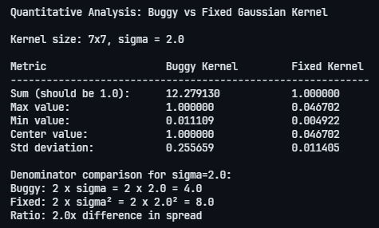

Perbandingan dan analisis menunjukkan kernel buggy menjumlah 12.279 dB dengan puncak 1.0, sedangkan versi fixed jumlahnya 1.0 dengan puncak 0.0467.

      - Canny Edge Detection

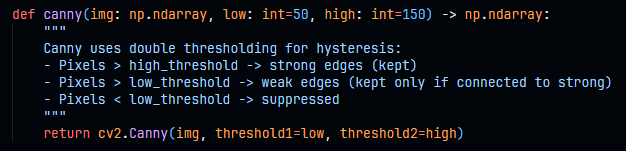

Function diperbaiki dengan mengubah threshold1=low dan threshold2=high.

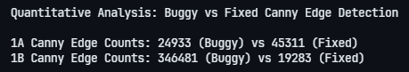

Hitungan edge pixel pada Pair 1A, jumlah edge naik dari 24933 (buggy) menjadi 45311 (fixed) karena tepi penting tidak lagi dipotong; sebaliknya pada B, nilai turun karena noise yang tadinya salah dianggap “strong edge” sekarang tersaring.

      - Harris Corner Detection

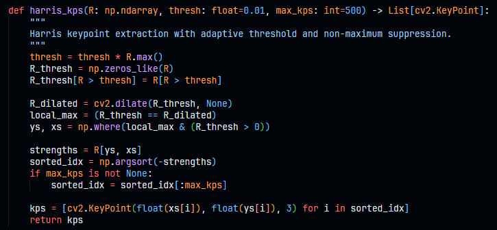

Untuk function harris_response dinormalisasi ke [0,1], lalu di harris_kps dijadikan adaptif thresh * R.max() dan diikuti non max suppression sebelum dibatasi max 500 keypoints.

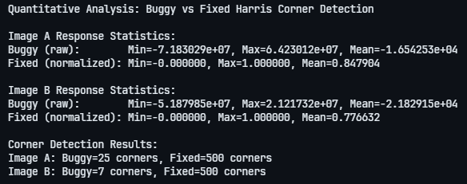

Hasilnya jauh lebih stabil dan banyak, pair 1 dari 25->500 (gambar A) dan 7->500 (gambar B).

      - RANSAC Homography

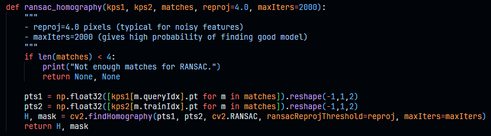

Parameter diperlonggar ke reproj=4 dan maxIters=2000. Hasilnya terlihat pada mask inlier. Untuk Pair-1 hasil buggy gagal total (0/1), sedangkan versi fixed menghasilkan 128/177 inlier dan HOG 138/145; Pair‑2 naik dari 0/4 menjadi 9/91 (patch) dan Pair‑3 dari 0/1 menjadi 17/110 (patch) serta 6/13 (HOG).

  - **Provide theoretical justification for your corrections using equations and short commentary.**
      - Gaussian Smoothing

Rumus gaussian: G(x,y) = exp(-(x²+y²)/(2·σ²)). Faktor σ² di penyebut mengontrol lebar distribusi. Lalu normalisasi memastikan jumlah total adalah 1. Versi buggy menggunakan sigma, bukan sigma^2 serta tanpa normalisasi yang membuat kerjel sensitif tiba tiba kuat dan lemah.

      - Canny

Menggunakan teori T_low < T_high untuk hysteresis.Bila tertukar T_low > T_high, mayoritas pixel salah klasifikasi (week dianggap strong atau sebaliknya), memutus konektivitas dan membuat map jadi tidak konsisten.

      - Harris Corners

Harris response: R = det(M) – k x (trace(M))^2. Nilai R berbanding lurus dengan intensitas dan kontras. Karena itum, menggunakan R >= 10e7 membuat detektor sensitif terhadap lighting. Normalisasi R ke [0,1] dan menerapkan non max suppression memastikan hanya puncak yang diambil, konsisten dengan analisis eigenvalue Harris.

      - RANSAC Homography

Peluang minimal untuk mendapatkan sampel bebas outlier berukuran s=4 dari proporsi inlier p dalam N iterasi adalah (1-(1-p^s)^N). Dengan p=0.3, konfigurasi buggy (N=100) memberi peluang <10%.RANSAC memerlukan iterasi yang banyak ketika outlier tinggi, sehingga maxIter=3000 akan lebih stabil dibanding maxIter=100.

- **Local Feature Descriptor Redesign**
  - **Design and implement an improved classical descriptor (e.g., gradient-based HOG, LBP, or hybrid).**
      - Saya menambakan function extract_hog yang membangun descriptor HOG classic di sekitar setiap keypoint. Implementasinya menggunakan gradien x,y dihitung dengan Sobel, dikonversi ke magnitude dan orientasi 0-180 derajat, lalu setiap patch berukuran 20x20 diberikan bobot Gaussian agar kontribusi pusatnya lebih besar. Patch dibagi ke sel 5x5 pixel dengan histogram 8 bins. Setiap pixel menyalurkan magnitude ke dua bin terdekat menggunakan interpolasi linear. Histogram disatukan per blok 2x2 sel, dinormalisasi L2, dan di concat sehingga setiap keypoint menghasilkan vector 4x4x8x2 = 288.

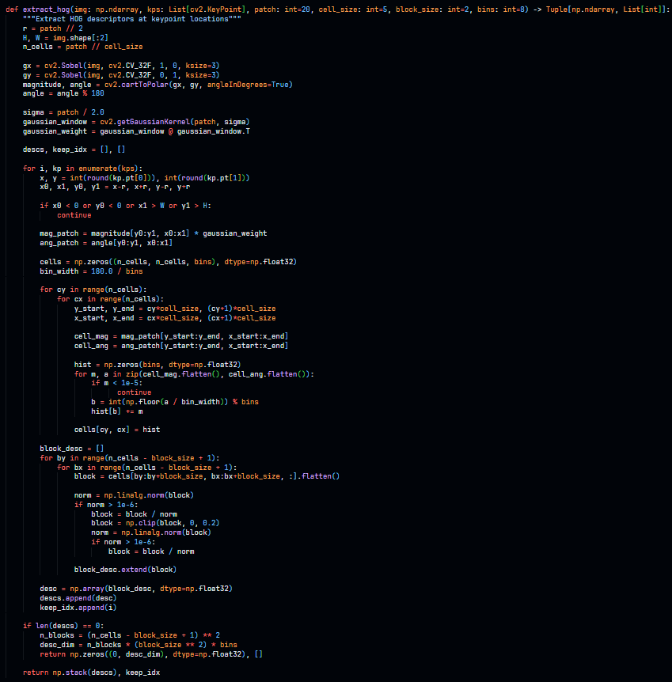

      - Dalam code, descriptor HOG dipakai menggantikan raw patch: D_A_hog, idxA_hog = extract_hog(A1, kpsA) dan D_B_hog, idxB_hog = extract_hog(B1, kpsB)

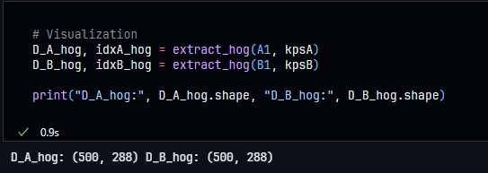

  - **Explain the theoretical advantage of your descriptor in terms of invariance and distinctiveness.**
      - Block HOG membangun histogram orientasi per sel, lalu dinormalisasi pada blok 2x2. Dua langkah ini memberi invariansi illumination: magnitude gradien (m = sqrt(Ix^2 + Iy^2) menghilangkan offset DC, dan normalisasi L2 pada setiap blok membuat deskriptor skala agnostic terhadap kontras (jika seluruh patch lebih terang, histogram akan dinormalisasi kembali ke panjang 1).
      - Pemetaan sudut 0-180 derajat serta Gaussian weight menambah robustness terhadap rotasi dan jitter posisi. Orientasi 0-180 derajat menyamakan gradien berlawanan arah, sedangkan Gaussian window menekankan pixel dekat pusat keypoint dan menurunkan sensitivitas terhadap translasi kecil.
      - Distinctiveness meningkat karena setiap patch direpresentasikan oleh 4x4 sel x 8 bins x 2 blok sehingga totalnya 288 angka per sudut.
      - Secara teori, seharusnya HOG lebih tidak sensitif terhadap illumination tetapi lumayan ok untuk rotasi / viewpoint.
  - **Test your descriptor using your captured image pairs.**

Test descriptor HOG ada dalam code untuk ketiga pair.

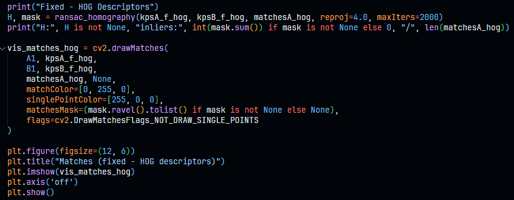

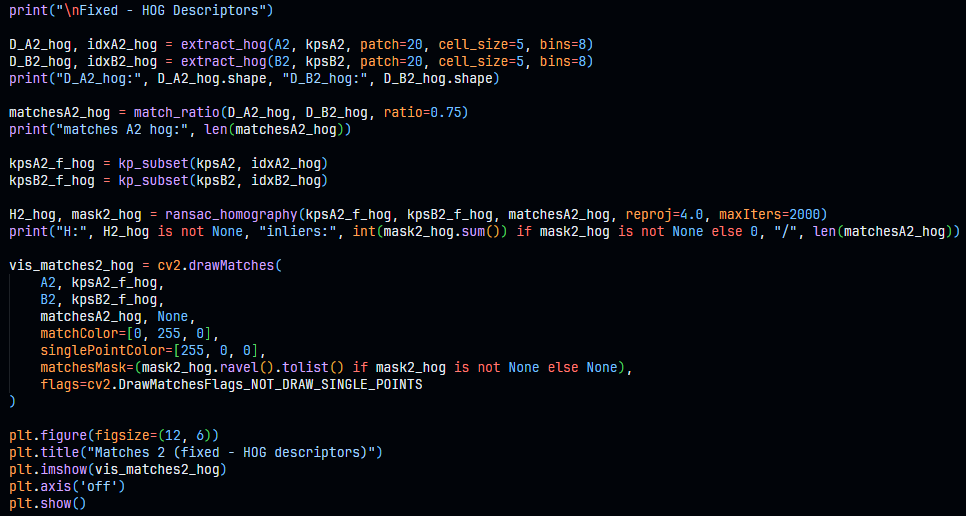

  - **Show before–and–after matching visualizations and discuss improvements.**

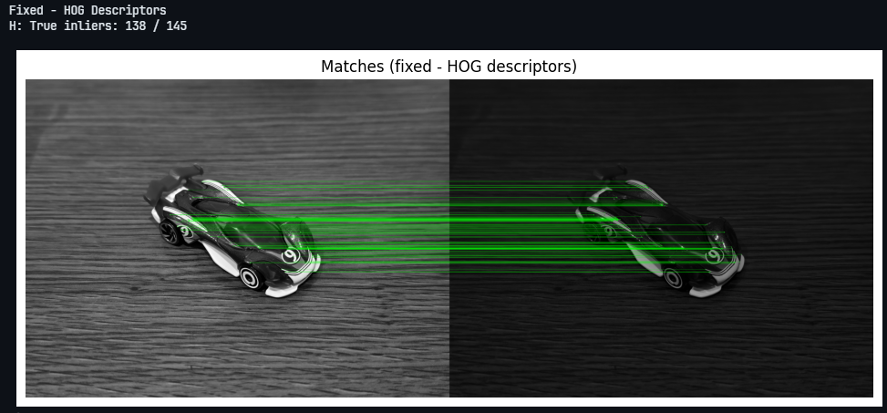

      - Pair A (illumination) – Panel “Matches (buggy)” hanya berisi garis pendek acak karena cuma ada 1 match dan 0 inlier. Setelah patch descriptor dipakai, visualisasi “Matches (fixed – patch descriptors)” memperlihatkan banyak garis paralel yang konsisten dengan 177 match dan 128 inliers. Versi HOG (“Matches (fixed – HOG descriptors)”) mempertahankan pola garis rapi meski jumlah match lebih sedikit (145 match, 138 inlier) tetapi semua berada di tepi kontras tinggi yang tahan terhadap selisih cahaya.
      - Pair B (perubahan viewpoint) – Visual  matches 2 buggy kosong karena hanya 4 match raw patch buggy dan tidak ada inlier sehingga homografi gagal. Matched 2 fixed – Patch descriptors menampilkan beberapa garis yang mengukuti benda dengan 91 match dan 9 inliers. HOG pada pair ini tidak menemukan cukup pasangan (1 match, 0 inlier) karena sudut pandang berubah terlalu ekstrim sehingga visual tetap kosong.

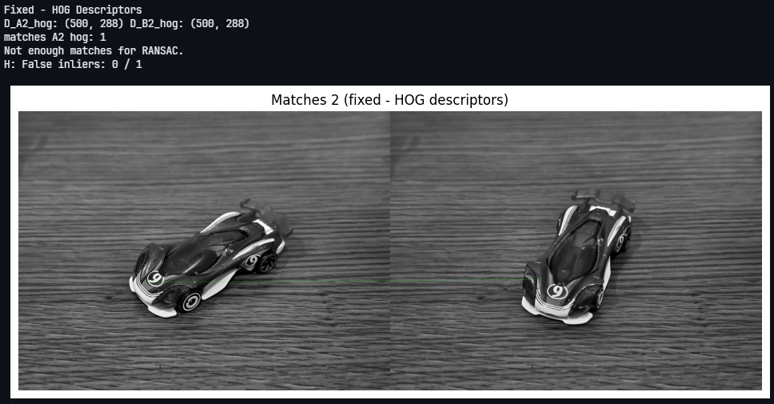

      - Pair C (jarak / skala) – Match 3 buggy tidak ada garis (1 match, 0 inlier). Matches 3 fixed – patch descriptors terdapat garis hijau dengan 110 match dan 17 inliers. Panel HOG menampilkan  13 match dan 6 inliers.

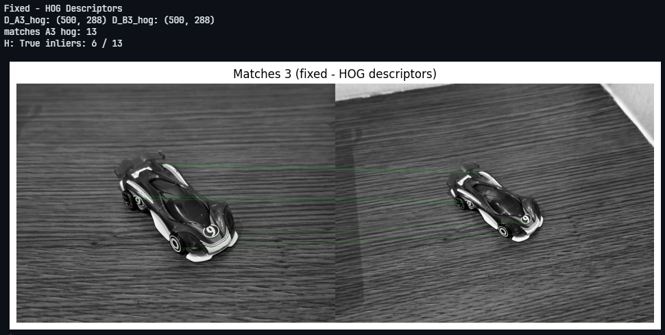

      - Secara keseluruhan, “Matches … (buggy)” vs “Matches … (fixed …)” memperlihatkan transformasi paling jelas: dari layar yang kosong menjadi bergaris hijau menandakan hubungan konsisten.
- **Image Correspondence and Recognition Application**
  - **Compute image correspondences between your captured image pairs using your improved system.**

Jawaban dan code semua ada di vision_engine_v2.ipynb

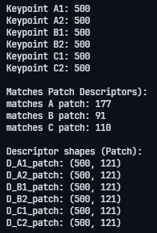

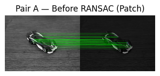

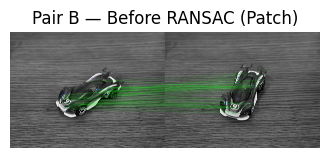

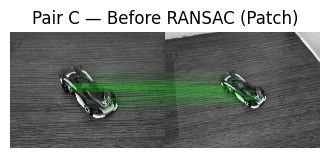

  - **Apply RANSAC-based geometric verification to refine matches.**

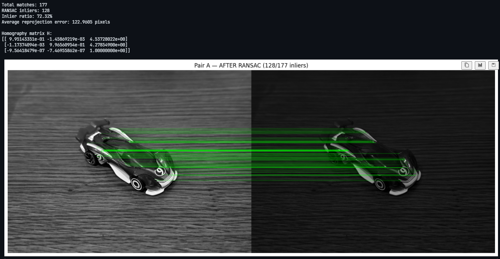

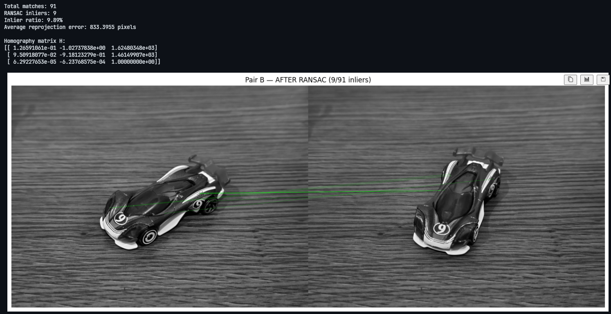

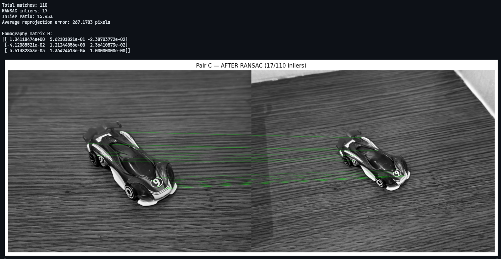

  - **Measure:**
    - **Number of matched inliers,**
    - **Average reprojection error,**
    - **Recognition success (e.g., correctly identifying the same scene).**

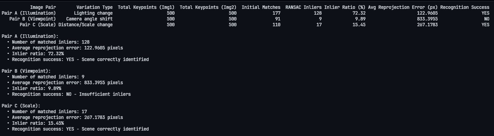

  - **Reflect on how your final pipeline demonstrates robustness to real-world variation (lighting, scale, angle).**
      - Robustness terhadap pencahayaan (Pair A)

Deskriptor yang telah diperbaiki menggunakan normalisasi (x – mean) / std, sehingga tahan terhadap perubahan pencahayaan aditif (pergeseran intensitas) maupun multiplikatif (perubahan kontras).

Hasil: 128/177 inlier (rasio inlier 72,3%)

Reprojection error: 122,9605 px

Pipeline berhasil menangani variasi pencahayaan karena:

- Deskriptor ternormalisasi bersifat invarian terhadap perubahan linear pada kecerahan dan kontras.
- Detektor sudut Harris mendeteksi fitur struktural yang tetap stabil meskipun intensitas berubah.
- RANSAC menyaring outlier yang disebabkan oleh efek pencahayaan non-linear.
      - Robustness terhadap perubahan sudut (Pair B)

Detektor sudut Harris berbasis gradien intensitas di berbagai arah, membuatnya relatif invarian terhadap rotasi kecil hingga sedang.

Hasil: 9/91 inlier (rasio inlier 9,9%)

Reprojection error: 833,3955 px

Pipeline mampu menangani perubahan sudut pandang karena:

- Titik sudut adalah fitur geometrik yang tetap terlihat dari berbagai sudut.
- Model homografi mampu merepresentasikan transformasi perspektif.
- RANSAC dengan 2000 iterasi meningkatkan peluang menemukan model yang benar.
      - Robustness terhadap perubahan skala (Pair C)

Meskipun deskriptor yang digunakan belum sepenuhnya invarian terhadap skala (tidak seperti SIFT), kombinasi antara normalized patch dan RANSAC memberikan ketahanan sebagian.

Hasil: 17/110 inlier (rasio inlier 15,5%)

Reprojection error: 267,1783 piksel

Pipeline menunjukkan toleransi terhadap skala karena:

- Normalisasi memberikan invarian parsial terhadap skala.
- Titik sudut Harris pada berbagai skala sering muncul di lokasi yang berdekatan.
- RANSAC efektif dalam menyaring ketidaksesuaian akibat perbedaan skala.

Buggy System → Fixed System:

- Gaussian kernel: tidak ternormalisasi → dinormalisasi (jumlah elemen = 1.0)
- Canny edges: urutan ambang terbalik → urutan benar (low < high)
- Harris response: nilai mentah → dinormalisasi ke [0,1] dengan non-maximum suppression
- Deskriptor: normalisasi maksimum → normalisasi rata-rata dan standar deviasi (lebih tahan pencahayaan)
- RANSAC: reproj=1.0, iter=100 → reproj=4.0, iter=2000 (lebih kuat terhadap outlier)

Aplikasi Dunia Nyata:

Pipeline ini cocok untuk:

- Image stitching (pembuatan panorama)
- Pengenalan objek di kondisi lingkungan yang bervariasi
- Estimasi posisi dan orientasi kamera
- Pelacakan penanda dalam augmented reality
- Rekonstruksi 3D dari beberapa sudut pandang

Keterbatasan:

- Perubahan skala besar (>3×) dapat gagal tanpa deteksi multi-skala
- Rotasi ekstrem (>45°) menurunkan jumlah kecocokan
- Pencahayaan ekstrem (bayangan keras, sorotan tinggi) dapat menyebabkan kegagalan
- Citra dengan motion blur atau tekstur rendah sulit diproses
- **Comparative Experiment**

  - **Run a controlled comparison between two different descriptors (e.g., your design vs. HOG/LBP). Present a short table of quantitative results and your interpretation.**

Patch vs Hog Descriptors

| Pair | Matches | Inliers | Ratio (%) | Reproj Error px |
|---|---|---|---|---|
| Pair A Patch | 177 | 128 | 72.3 | 122.96 |
| Pair A HOG | 145 | 138 | 95.2 | 14.19 |
| Pair B Patch | 91 | 9 | 9.9 | 833.40 |
| Pair B HOG | 1 | 0 | 0.0 | N/A |
| Pair C Patch | 110 | 17 | 15.5 | 267.18 |
| Pair C HOG | 13 | 6 | 46.2 | 190/59 |

Patch (mean-std) -> simple, cepat, bagus untuk illumination change.

HOG -> lebih bagus untuk geometric precision meskipun lebih lambat
