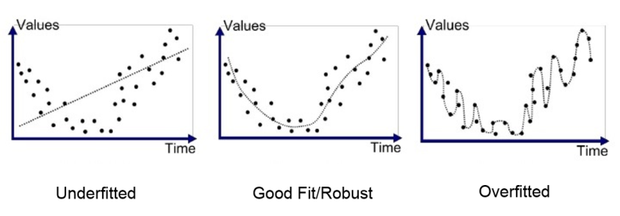
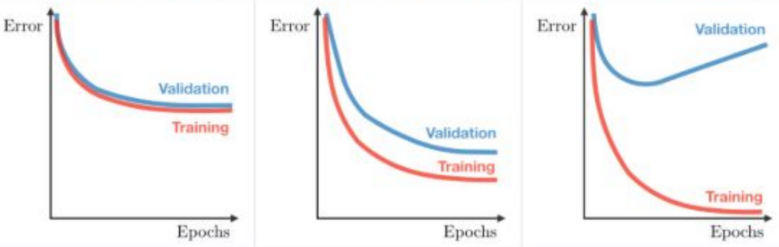
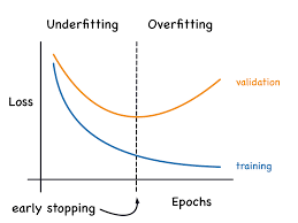

# **Introduction to Deep Learning**

Reminder: Buka course outline di acad juga

## **Introduction**

### **Dataset**

Group of data that will be used by our AI Model to learn

Dataset is divided into 3

1. Training set (approx. 60%)

Used to train data into our model

2. Validation set

Used to validate the training result, to try validate the model that was trained

3. Testing set

Used by our model to predict

# **Metric Evaluation**

### **Accuracy**

Accuracy is used in classification tasks, it measures how often the model correctly predict the label.

### **Loss**

Loss is the difference of the model prediction and the true label, can be used for many task, such as regression tasks, etc. Good and balanced model will have the loss decrease over iterations.

# **Epoch vs. Batch vs. Step**

Epoch:

Iteration of the data trained to the model

One complete pass through the entire dataset

Batch:

Subset of training data used in one iteration, improves computational efficiency by procesing data in smaller chunks.

Step:

One iteration where the parameter models are updated based on the gradient calculated from the batch. (Represents one update to the model's weight)

# **What is preprocessing?**

Process data before fed into the model

Example:

We want to delete unwanted/noise data by preprocessing: Data Cleaning

We want to encode class in a classification task: Data Encoding

### **Data Encoding** :

Label Encoding: using category number from 1 to n

One Hot Encoding: creating new class for each category

**One Hot Encoding**

Label Encoding

| Food Name | Categorical # | Calories |
| --- | --- | --- |
| Apple | 1 | 95 |
| Chicken | 2 | 231 |
| Broccoli | 3 | 50 |

One Hot Encoding

| Apple | Chicken | Broccoli | Calories |
| --- | --- | --- | --- |
| 1 | 0 | 0 | 95 |
| 0 | 1 | 0 | 231 |
| 0 | 0 | 1 | 50 |

# **Model Performance Classification**

How good our model is:

### Underfit

The model is not properly trained enough yet, it doesn't recognize the pattern enough. The model is too simple to recognize any meaningful patterns.

Overfit

The model is trained very hard that it is accurate to only by the training data, it doesn't recognize the generalization of data.

- Balanced Model

What we sthrive for

### **How to combat Underfitting & Overfitting**

- **Data preprocessing**

- **Adapting Appropriate Model, Layers, Activation Function, etc.**

- **Hyperparameter Tuning**

- **Regularization Techniques** (Specific to Overfitting)

**Early Stopping**

