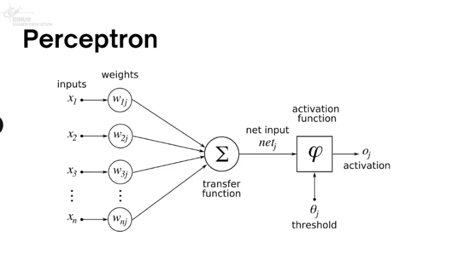
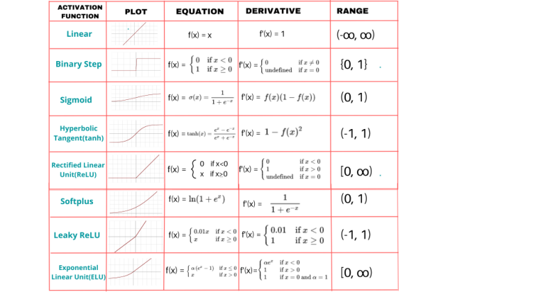
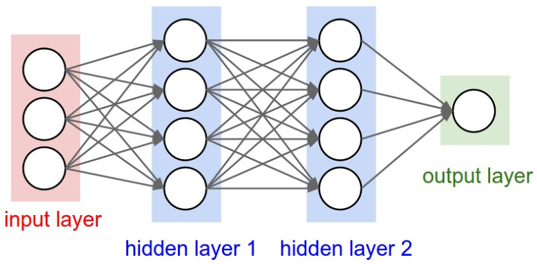
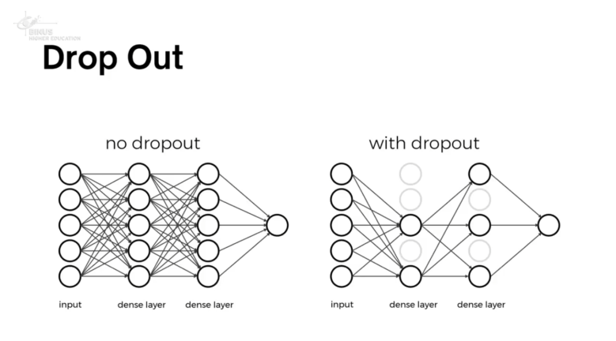
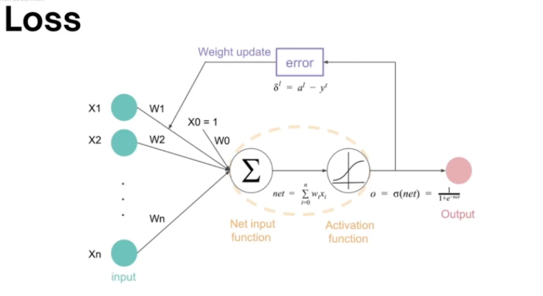
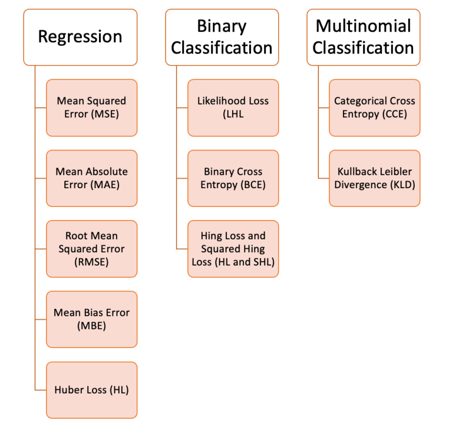

# **Perceptron (SLP & MLP)**

Bagian utama dari Neural Network

Seperti neuron di otak namun artificial

Memiliki input, bias, dan weight yang akan diubah-ubah dalam tahap pembelajaran model

We are calculating which weight is suitable for the output that was wanted, we are adjusting bias value so that the output is

```
w0 * x0 + w1 * x1 + bias
```



# **What is Weight & Bias?**

Fundamental parameters of neural network that determine it learning capabilities

**Weights** : Numerical values assigned to the connections between neurons **Bias:** Numerical values added to weighted sum of the inputs before the activation function

Each weight and bias determines how much importance each input to the output result.

# **What is Threshold?**

Ketika outputnya dibawah suatu angka maka dianggap 0, dan diatas suatu angka maka akan dianggap 1.

## **Default: 0.5**

< 0.5 prediksi negatif (0)

- >0.5 prediksi positif (1)

# **What is Activation Function?**

Mathematical function that applied to the output of a neuron. It determines whether a neuron should be activated or not based on the input it receives. The primary reason for using activation function is to introduce **non-linearity** into the neural network. Non-linearity is crucial for learning complex patterns in data because real-world data is rarely linear.



Extra:

## **Softmax function**

Function that turns a vector of K real values into a vector of K real values that sum to 1.

# **What is Layer?**

Parts of model

Input Layer

The first and forefront layer that receives the data.

The input layer shape must follow the shape of the data.

Hidden Layer

Layer that is in between input and output layer

Called _hidden_ because the value of the hidden layer is not usually can be seen, we only see the input (data) and the output (model prediction)

Output Layer

Layer that output the last prediction result.

The output layer shape is customized to follow the class label.

Each neuron connections in each layer have their own weight and bias except **Input Layer** .



For a perceptron to be called **deep learning** , the perceptron must have minimal **3 hidden layers** .

# **What is Dropout Layer?**

Types of layer that can be used to combat overfitting. For each iteration in the training, some percentage of the neurons is randomly disabled so that the neurons in the next layer don't rely heavily on one specific neurons. Dropout layer is only used on training and is removed on inference phase.

Disadvantage: Slows down the learning process



# **What is Loss?**

Calculating distance between model prediction and the true labels. On the training phase, model will try to predict and calculate the loss. The model goals is to minimize the loss result from the model predictions.

Loss is used to adjust the weight and bias in the model (also called **Back propagation** )



Loss can be calculated through different loss functions based on the model and task given.

Common loss functions

- **Binary Cross Entropy** : Used if the classification output is binary (True/False) **Categorical Cross Entropy** : Used if the classification output is more than two and the data class is already processed through **OneHotEncoding** .

- **Sparse Categorical Cross Entropy:** Similar to categorical cross entropy, but for datas that are not OneHotEncoded, so the data is still on the unique integer form.



**What are optimizers?**

Algorithm that helps improve deep learning model performance. These optimizers are used to update the attributes (bias and weights) in the deep learning models.

Popular Optimizers are:

SGD (Stochastic Gradient Descent)

Adam Optimizer

### Optimizers

| Optimizer | Update rule |
| --- | --- |
| Gradient Descent | $\theta = \theta - \alpha \cdot \nabla_\theta J(\theta)$ |
| Stochastic Gradient Descent | $\theta = \theta - \alpha \cdot \nabla_\theta J(\theta; sample)$ |
| Mini-Batch Gradient Descent | $\theta = \theta - \alpha \cdot \nabla_\theta J(\theta; N\ samples)$ |
| SGD + Momentum | $v = \gamma \cdot v + \eta \cdot \nabla_\theta J(\theta)$, $\theta = \theta - \alpha v$ |
| SGD + Momentum + Acceleration | $v = \gamma \cdot v + \eta \cdot \nabla_\theta J(\theta - \gamma \cdot v)$, $\theta = \theta - \alpha v$ |
| Adagrad | $\theta_{t+1,i} = \theta_{t,i} - \dfrac{\eta}{\sqrt{G_{t,ii} + \epsilon}} \nabla_{\theta_{t,i}} J(\theta_{t,i})$ |
| Adadelta | $\theta_{t+1,i} = \theta_{t,i} - \dfrac{\eta}{\sqrt{E[G_{t,ii}] + \epsilon}} \nabla_{\theta_{t,i}} J(\theta_{t,i})$ |
| Adam | $\theta_{t+1,i} = \theta_{t,i} - \dfrac{\eta}{\sqrt{E[G_{t,ii}] + \epsilon}} \times E[g_{t,i}]$ |

More about optimizers: (17) Optimizers - EXPLAINED! - YouTube\
