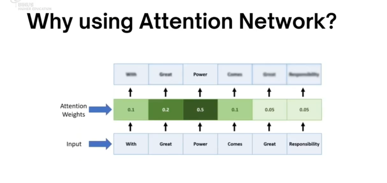
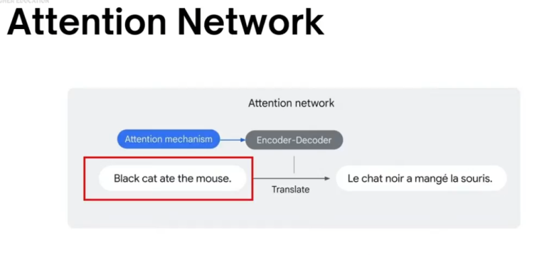
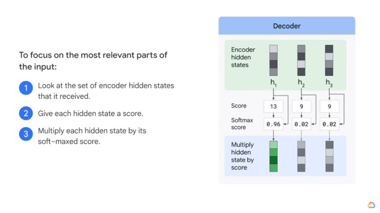
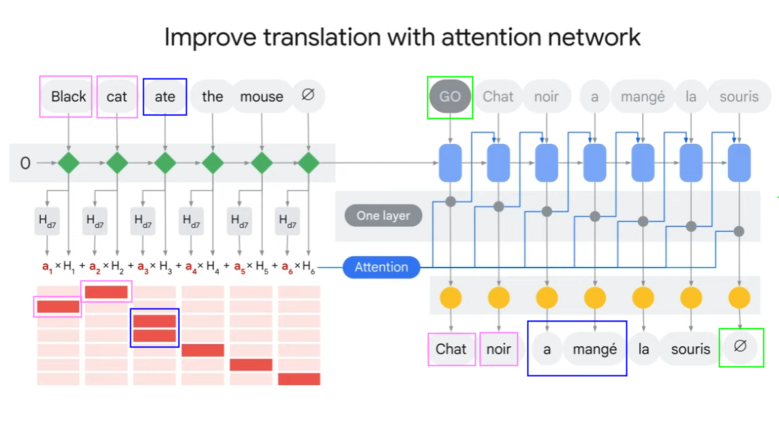
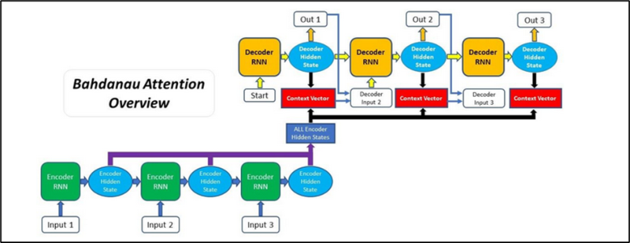

# **Recurrent Neural Networks with Attention Mechanism**

## **Attention Mechanism**

Technique that allows model to choose and focus on specific (important) part of the input data. It helps our model to give more _attention_ to relevant/important features when creating decision or generating an output.

Attention network will give **attention weights** for each element inputs to help model selectively **concentrate on certain aspects of information** .

Attention will help model to focus on specific information that will help the task, rather than learning from all the input data all at once.

Give translation task for example! <u>Attention for Neural Networks, Clearly Explained!!! (youtube.com) Attention mechanism: Overview (youtube.com)</u>

## **How the decoder works:**

Now, for each iteration, the attention will generate the score of importance of each word when trying to predict the translation of the next word.

Attention network can specifically be applied to translation:

- Pink: Sometimes the structure of the sentence can change

- Blue: Sometimes one word in a language can generate multiple word

- Green: It will start with a starttoken, and the predictions will end when it predicts the endtoken.

## **Bahdanau Attention**

A type of mechanism used in neural networks, particularly in sequence-to-sequence models like **machine translation** .

How it works:

### **Encoder**

Input sequence is processed by an encoder, which produces a **set of hidden states** , one for each input token.

### **Decoder**

At each time step, the decoder **calculates the attention score** for each encoder hidden state. This is done by concatenating previous decoder hidden state with each encoder hidden state, passing through a feedforward neural network, and applying a softmax function to obtain **attention weights** .

### **Context Vector** :

The attention weights are used to compute a context vector, which is a weighted sum of

the encoder hidden states.

### **Output Generation**

The context vector, along with the previous decoder hidden state, is used to generate the next output token.

