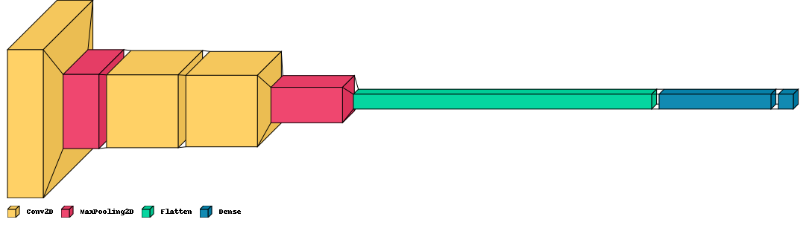
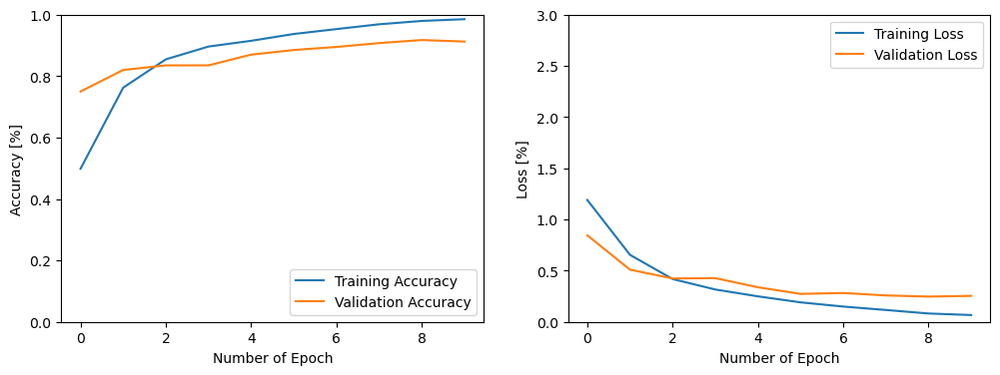
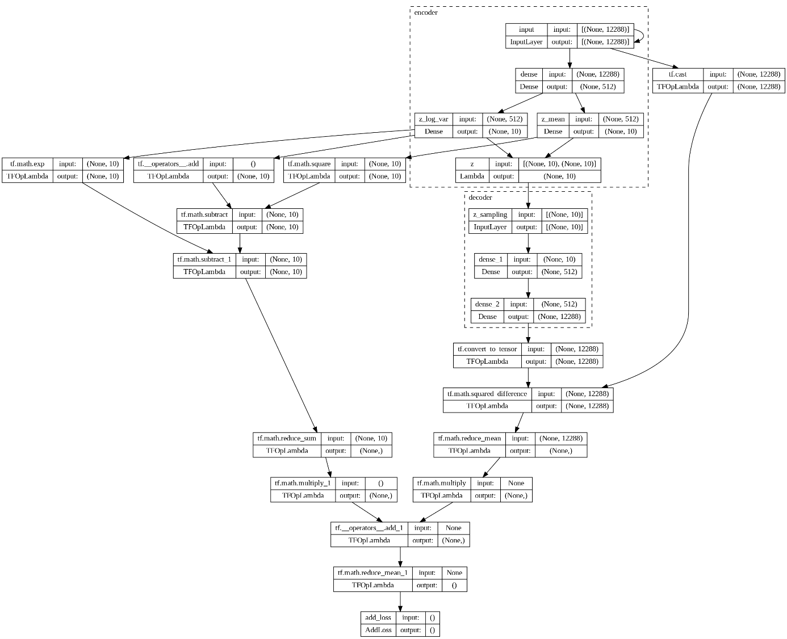
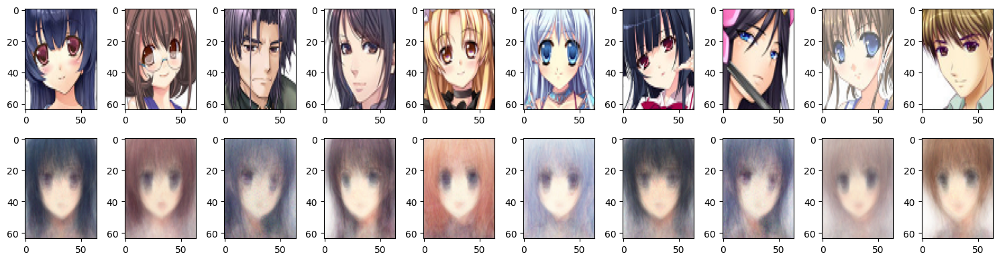

# Transformers Question

## Vegetables Classification using Deep Convolutional Neural Network

**VeggieLKa** is set to make a significant impact in the agri-tech sector by promoting sustainable agriculture and healthy eating. Their goal is to introduce an innovative system that enhances the classification and sorting of vegetables on a granular level, ultimately improving the efficiency and precision of global vegetable supply chains.

As the latest recruit, you are tasked with spearheading this groundbreaking project. Your mission is to develop a Python-based program utilizing the TensorFlow library to craft a Deep Convolutional Neural Network (DCNN) model. This advanced model will specialize in accurately distinguishing between **four primary vegetable classes**: Broccoli, Carrot, Cucumber, and Tomato. Your task as a deep learning engineer is to develop a Python-based program using the **TensorFlow library** to create a **Deep Convolutional Neural Network (DCNN) model** that meets the following requirements:

- **Load and Split Dataset**
    - **Load Dataset**

        In this section, you are required to:

        - **Assign** the dataset path to the previously declared PATH variable.
        - **Populate** the CLASS_NAMES variable with the appropriate class names based on the provided information.
        - **Load** the image from the given dataset into an array using grayscale as the color mode.
        - **Randomly** shuffle the dataset.
    - **Split Dataset**

        You are tasked to **split** the given dataset into 3 main parts which are training, validation, and testing sets with the proportion of 80/10/10.

- **Data Preprocessing**

    You are tasked with **reshaping** the given dataset, which includes the training, validation, and testing sets, by converting the data type to float32. Following this, you will need to **normalize** the dataset, comprising the training, validation, and testing sets, by dividing the values of all image pixels by 255. As an optional but potentially beneficial step, consider utilizing **categorical encoding** for the target variables in the training, validation, and testing sets.

- **DCNN Architecture (Model Architecture Visualization, Initialization, and Configuration)**
    - **Model Visualization**

        

        *Figure 1. Model Visualization*

    - **Model Initialization and Configuration – Input Layer**

        In this section, you are tasked with initializing the **input layer** of the model. You need to define the dimensions of the image and the channel to be processed by the input layer.

    - **Model Initialization and Configuration – Hidden Layer**

        In this section, your responsibility is to outline the configurations of the hidden layers of the DCNN model. The architecture comprises a sequence of components including **convolutional layers**, **max pooling layers**, and a **flatten layer**. These layers are essential in extracting and reducing the dimensions of the feature maps as the data progresses through the network.

    - **Model Initialization and Configuration – Output Layer**

        In this section, you are tasked with describing the output layer of the DCNN model. The output section of the model consists of **two dense layers**: one employing a ReLU activation function and the final layer utilizing a Softmax activation function to classify the input into one of several categories.

    - **Model Training**

        You are tasked with **training the model** that you previously constructed. **Utilize** the Adam optimizer and **select** the appropriate loss function based on the specifics of your case. **Monitor** the performance using accuracy as the metric. Ensure that the training process spans a minimum of 10 epochs. You have the flexibility to set the batch size and learning rate for the optimizer according to your judgment.

        ```text
        Epoch 1/10
        50/50 [==============================] - 363s 7s/step - loss: 1.1905 - accuracy: 0.4984 - val_loss: 0.8457 - val_accuracy: 0.7500
        Epoch 2/10
        50/50 [==============================] - 340s 7s/step - loss: 0.6550 - accuracy: 0.7625 - val_loss: 0.5102 - val_accuracy: 0.8200
        Epoch 3/10
        50/50 [==============================] - 336s 7s/step - loss: 0.4181 - accuracy: 0.8547 - val_loss: 0.4239 - val_accuracy: 0.8350
        Epoch 4/10
        50/50 [==============================] - 326s 7s/step - loss: 0.3162 - accuracy: 0.8963 - val_loss: 0.4272 - val_accuracy: 0.8350
        Epoch 5/10
        50/50 [==============================] - 342s 7s/step - loss: 0.2493 - accuracy: 0.9150 - val_loss: 0.3381 - val_accuracy: 0.8700
        Epoch 6/10
        50/50 [==============================] - 393s 8s/step - loss: 0.1905 - accuracy: 0.9372 - val_loss: 0.2730 - val_accuracy: 0.8850
        Epoch 7/10
        50/50 [==============================] - 355s 7s/step - loss: 0.1495 - accuracy: 0.9531 - val_loss: 0.2819 - val_accuracy: 0.8950
        Epoch 8/10
        50/50 [==============================] - 361s 7s/step - loss: 0.1162 - accuracy: 0.9688 - val_loss: 0.2582 - val_accuracy: 0.9075
        Epoch 9/10
        50/50 [==============================] - 368s 7s/step - loss: 0.0818 - accuracy: 0.9797 - val_loss: 0.2468 - val_accuracy: 0.9175
        Epoch 10/10
        50/50 [==============================] - 366s 7s/step - loss: 0.0667 - accuracy: 0.9853 - val_loss: 0.2539 - val_accuracy: 0.9125
        ```

        *Figure 2. Model Training*

- **Predicting Data Using Created Model and Model Evaluation**
    - **Predict Data**

        You are tasked with **predicting** the outcomes of the testing sets using the model that you previously constructed. Please print out both the loss and accuracy values.

        ```text
        13/13 [==============================] - 13s 1s/step
        13/13 [==============================] - 13s 964ms/step - loss: 0.2857 - accuracy: 0.9150

        Test Accuracy :  0.9150000214576721
        Test Loss     :  0.28565454483032227
        ```

        *Figure 3. Model Prediction*

    - **Model Evaluation**

        You are tasked with **evaluating** the testing sets using the model that you previously constructed. Please print out both the loss and accuracy values.

        ```text
        13/13 [==============================] - 13s 1s/step
        13/13 [==============================] - 13s 964ms/step - loss: 0.2857 - accuracy: 0.9150

        Test Accuracy :  0.9150000214576721
        Test Loss     :  0.28565454483032227
        ```

        *Figure 4. Model Evaluation*

- **Plot of Evaluation Metrics**

    You are tasked with creating a **plot** of the evaluation metrics. This plot should include a loss graph, which displays both the training and validation losses, as well as an accuracy graph that illustrates the training and validation accuracies.

    

    *Figure 5. Plot of Evaluation Metrics*

## Generate Anime Faces using Variational Autoencoders (VAEs)

**Variational Autoencoders** (VAEs) are a type of generative model particularly suited for image editing through concept vectors. They are an evolution of autoencoders, which are designed to compress input data into a lower-dimensional latent space and then reconstruct it. The unique feature of VAEs is that they regularize the distribution of their encodings during training. This ensures that their latent space is structured in a manner that facilitates the generation of new samples.

As a specialist in deep learning, you are tasked with crafting a **Python** program leveraging the **TensorFlow library**. Your goal is to construct a **Variational Autoencoders (VAEs) model** in line with the subsequent criteria:

- **Load and Split Dataset**
    - **Load Dataset**

        In this section, you are required to:

        - **Assign** the dataset path to the previously declared PATH variable.
        - **Load** the image from the given dataset into an array using RGB as the color mode.
        - **Randomly** shuffle the dataset.
    - **Split Dataset**

        You are tasked to **split** the given dataset into 3 main parts which are training, validation, and testing sets with the proportion of 80/10/10.

- **Data Preprocessing**

    You are tasked with **reshaping** the given dataset, which includes the training, validation, and testing sets, by converting the data type to float32. Following this, you will need to **normalize** the dataset, comprising the training, validation, and testing sets, by dividing the values of all image pixels by 255.

- **Variational Autoencoders Architecture (Model Architecture Visualization, Initialization, and Configuration)**
    - **Model Visualization**

        

        *Figure 1. Model Visualization*

    - **Model Initialization and Configuration – Encoder**

        **Input Layer:** This takes the data (like an image) as input.

        **Hidden Layers:** One or more layers that transform the input data. These can be fully connected layers, convolutional layers, or any other type of layer suitable for the data type.

        **Output Layer:** Produces two vectors for each input data point: a mean vector $(\mu )$ and a log variance vector $(\log (\sigma^{2}))$.

        These vectors are used to parameterize the Gaussian distribution from which we’ll sample the latent variable ‘z’.

    - **Model Initialization and Configuration – Decoder**

        This is a lower-dimensional space where we encode our data. A point ‘z’ in this space is sampled from the Gaussian distribution parameterized by $\mu$ and $\log (\sigma^{2})$ from the encoder. The **reparameterization trick** is used here to make this sampling process differentiable. Instead of directly sampling from the distribution, we sample from a standard normal distribution and then scale and shift using µ and σ. The **formula** for the **reparameterization trick** is $z=\mu +\sigma \odot \epsilon$, where μ is the mean vector produced by the encoder, σ is the standard deviation, and ϵ is a random noise sampled from a standard normal distribution.

    - **Model Initialization and Configuration – Decoder**

        **Input Layer:** Takes the sampled ‘z’ from the latent space.

        **Hidden Layers:** One or more layers that transform the latent variable back towards the original data’s dimensionality.

        **Output Layer:** Produces the reconstructed data, ideally as close to the original input data as possible.

- **Model Training**

    You are tasked with **training the model** that you previously constructed. **Utilize** the Adam optimizer and **select** the appropriate loss function based on the specifics of your case. **Monitor** the performance using **reconstruction loss** and **KL Divergence** as the metric. Ensure that the training process spans a minimum of 60 epochs. You have the flexibility to set the batch size and learning rate for the optimizer according to your judgment.

    ```text
    Epoch 45/60
    7/7 [==============================] - 0s 14ms/step - loss: 593.3033 - val_loss: 598.2786
    Epoch 46/60
    7/7 [==============================] - 0s 14ms/step - loss: 596.2701 - val_loss: 581.5677
    Epoch 47/60
    7/7 [==============================] - 0s 14ms/step - loss: 577.7838 - val_loss: 552.3345
    Epoch 48/60
    7/7 [==============================] - 0s 14ms/step - loss: 576.7697 - val_loss: 559.6485
    Epoch 49/60
    7/7 [==============================] - 0s 13ms/step - loss: 572.0773 - val_loss: 565.2842
    Epoch 50/60
    7/7 [==============================] - 0s 14ms/step - loss: 570.7422 - val_loss: 559.0742
    Epoch 51/60
    7/7 [==============================] - 0s 12ms/step - loss: 560.4667 - val_loss: 565.4388
    Epoch 52/60
    7/7 [==============================] - 0s 14ms/step - loss: 570.7066 - val_loss: 556.9673
    Epoch 53/60
    7/7 [==============================] - 0s 14ms/step - loss: 573.2571 - val_loss: 588.6973
    Epoch 54/60
    7/7 [==============================] - 0s 13ms/step - loss: 590.3951 - val_loss: 595.6373
    Epoch 55/60
    7/7 [==============================] - 0s 13ms/step - loss: 593.3549 - val_loss: 588.0681
    Epoch 56/60
    7/7 [==============================] - 0s 14ms/step - loss: 576.4164 - val_loss: 580.3112
    Epoch 57/60
    7/7 [==============================] - 0s 14ms/step - loss: 569.9215 - val_loss: 558.7477
    Epoch 58/60
    7/7 [==============================] - 0s 13ms/step - loss: 562.8151 - val_loss: 553.3840
    Epoch 59/60
    7/7 [==============================] - 0s 14ms/step - loss: 554.1800 - val_loss: 551.1498
    Epoch 60/60
    7/7 [==============================] - 0s 13ms/step - loss: 555.4429 - val_loss: 548.2463
    ```

    *Figure 2. Model Training*

- **Predicting Data Using Created Model and Model Evaluation**

    You are tasked with **evaluating** the testing sets using the model that you previously constructed. **Display** both the **original and the reconstructed images**, **showcasing 10 images each**.

    

    *Figure 3. Original Images and Reconstructed Images*
