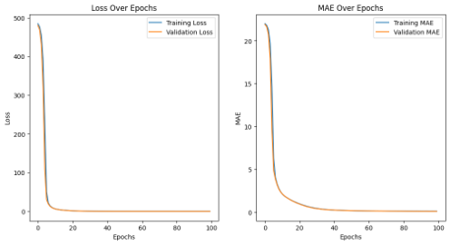
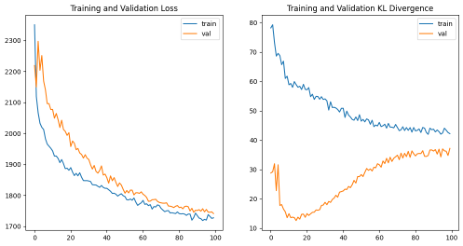
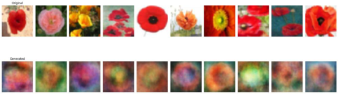
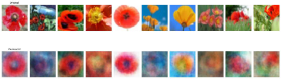
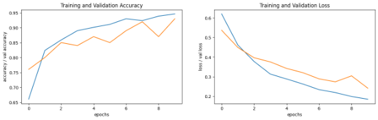

# Exam Answers

## **I. Case (100%)**

1. **[LO 1, LO 2, LO 3, LO 4 – 30 points]** Deep learning for room temperature prediction.

Instruction:

1. Clone the following repository: <https://github.com/wawancenggoro/Room-Climate-Datasets>

2. Add your student ID in get_dataset_part.ipynb in the repository, then run the notebook

3. Use the files as printed in the notebook as your dataset

```text
Please use the following files:
    * Room-Climate-Datasets/datasets-location_C/room_climate-location_C-measurement14.csv
    * Room-Climate-Datasets/datasets-location_C/room_climate-location_C-measurement15.csv
```

### TODOS:

- a. **[10 points]** Construct and train a deep learning model with temperature, relative humidity, light sensor 1, and light sensor 2 as input, and the temperature of the next timestamp (next row in the csv files) as the label. You can set each of the hyperparameters to any value.

```python
features = df[['Temp', 'RelH', 'L1', 'L2']].values[:-1]
target = df['Temp'].shift(-1).values[:-1]

# Split data 80/10/10
x_train, x_temp, y_train, y_temp = train_test_split(features, target, test_size=0.2, random_state=42)
x_test, x_val, y_test, y_val = train_test_split(x_temp, y_temp, test_size=0.5, random_state=42)
```

```python
model_v1 = tf.keras.Sequential([
    tf.keras.layers.Dense(32, activation='relu', input_shape=(x_train.shape[1],)),
    tf.keras.layers.Dense(16, activation='relu'),
    tf.keras.layers.Dense(8, activation='relu'),
    tf.keras.layers.Dense(1)
])
```

- b. **[5 points]** Plot the training and validation losses over epochs, analyze and explain what happens in the training based on the plot.



Analisis model v1:

1. **Rapid Initial Learning (Epoch 1-20):**
   - Loss turun drastis dari 484.78 menjadi 1.82 dalam 20 epoch pertama
   - Ini menunjukkan model dapat dengan cepat mempelajari pola dasar dari data
   - Training dan validation loss bergerak parallel -> indikasi learning sehat

2. **Gradual Refinement (Epoch 20-80):**
   - Penurunan loss melambat dan menjadi lebih stabil
   - Training loss: 1.82 -> 0.03
   - Validation loss: 1.70 -> 0.02
   - Gap antara training dan validation loss tetap kecil -> indikasi overfitting minimal

3. **Convergence (Epoch 80-100):**
   - Model mencapai final validation loss 0.0212 (MAE 0.112)
   - Loss curves menunjukkan konvergensi yang stabil
   - Tidak ada tanda-tanda overfitting atau underfitting (validation loss tidak naik)

- c. **[10 points]** Do hyperparameter tuning to improve the deep learning model based on the result of point b and any other results you get from the training process.

```python
# Model V2
model_v2 = tf.keras.Sequential([
    tf.keras.layers.Dense(64, activation='relu', input_shape=(x_train.shape[1],)),
    tf.keras.layers.Dense(32, activation='relu'),
    tf.keras.layers.Dense(16, activation='relu'),
    tf.keras.layers.Dense(8, activation='relu'),
    tf.keras.layers.Dense(1)
])

model_v2.compile(
    optimizer=tf.keras.optimizers.Adam(learning_rate=0.005),
    loss='mse',
    metrics=['mae']
)

early_stopping_v2 = tf.keras.callbacks.EarlyStopping(
    monitor='val_loss',
    patience=5,
    restore_best_weights=True
)

history_v2 = model_v2.fit(
    x_train, y_train,
    validation_data=(x_val, y_val),
    epochs=100,
    batch_size=32,
    callbacks=[early_stopping_v2]
)
```

```python
# Model V3
model_v3 = tf.keras.Sequential([
    tf.keras.layers.Dense(64, activation='relu', input_shape=(x_train.shape[1],), kernel_regularizer=regularizers.l2(1e-5)),
    tf.keras.layers.Dense(32, activation='relu', kernel_regularizer=regularizers.l2(1e-5)),
    tf.keras.layers.Dense(16, activation='relu', kernel_regularizer=regularizers.l2(1e-5)),
    tf.keras.layers.Dense(8, activation='relu'),
    tf.keras.layers.Dense(1)
])

model_v3.compile(
    optimizer=tf.keras.optimizers.Adam(learning_rate=0.0005),
    loss='mse',
    metrics=['mae']
)

early_stopping_v3 = tf.keras.callbacks.EarlyStopping(
    monitor='val_loss',
    patience=8,
    restore_best_weights=True
)

history_v3 = model_v3.fit(
    x_train, y_train,
    validation_data=(x_val, y_val),
    epochs=100,
    batch_size=16,
    callbacks=[early_stopping_v3]
)
```

Model 3 paling bagus (Hasil dalam notebook room-temperature-prediction.ipynb)

- d. **[5 points]** Test the model on a separate test set with appropriate metrics

```python
y_pred_v3 = model_v3.predict(x_test)
test_mse_v3 = mean_squared_error(y_test, y_pred_v3)
test_mae_v3 = mean_absolute_error(y_test, y_pred_v3)
test_rmse_v3 = np.sqrt(test_mse_v3)

print("Model v3:")
print(f"Test MSE:  {test_mse_v3}")
print(f"Test MAE:  {test_mae_v3}")
print(f"Test RMSE: {test_rmse_v3}")

if test_mae_v3 < test_mae_v2:
    improvement = ((test_mae_v2 - test_mae_v3) / test_mae_v2) * 100
    print(f"\n{improvement:.2f}% better than v2")
```

```text
10/10 ━━━━━━━━━━━━━━━━━━━━ 0s 4ms/step
Model v3:
Test MSE:  0.012590331408624207
Test MAE:  0.08819627355356686
Test RMSE: 0.11220664600915672

10.77% better than v2
```

2. **[LO 1, LO 2, LO 3, LO 4 – 70 points]** Deep learning for AI-generated image prediction.

Instruction:

1. Clone the following repository: <https://github.com/wawancenggoro/CIFAR-100-dataset> 2. Add your student ID in get_class_to_work.ipynb in the repository, then run the notebook

3. Use the class as printed in the notebook from the train folder as your training dataset

```text
Please use the following class: poppy
```

TODOS:

- a. **[10 points]** Construct and train a deep learning model as an image generator by using the images in your training dataset to train the model.

```python
# model VAE
class VAE(tf.keras.Model):
    def __init__(self, dim, **kwargs):
        super(VAE, self).__init__(**kwargs)
        dim_h = dim[0]
        dim_z = dim[1]

        self.fc1 = tf.keras.layers.Dense(dim_h, activation=tf.nn.relu)
        self.fc2 = tf.keras.layers.Dense(dim_z)
        self.fc3 = tf.keras.layers.Dense(dim_z)
        self.fc4 = tf.keras.layers.Dense(dim_h)
        self.fc5 = tf.keras.layers.Dense(IMAGE_SIZE)

        self.encode_batch_norm = tf.keras.layers.BatchNormalization()
        self.decode_batch_norm = tf.keras.layers.BatchNormalization()

    def encode(self, x):
        x = self.encode_batch_norm(x)
        h = self.fc1(x)
        return self.fc2(h), self.fc3(h)

    def decode_logit(self, z):
        h = self.fc4(z)
        h = self.fc5(h)
        return self.decode_batch_norm(h)

    def decode(self, z):
        return tf.nn.sigmoid(self.decode_logit(z))

    def reparameterize(self, mu, log_var):
        std = tf.exp(0.5 * log_var)
        eps = tf.random.normal(std.shape)
        return mu + std * eps

    def call(self, input, training=None, mask=None):
        mu, log_var = self.encode(input)
        z = self.reparameterize(mu, log_var)
        x_recon_logit = self.decode_logit(z)
        return x_recon_logit, mu, log_var
```

- b. **[5 points]** Plot the training and validation losses over epochs, analyze, and explain what happened in the generative training based on the plot.



### **VAE Loss Analysis**

   1. Convergence pattern: Kedua loss (training dan validation) menunjukkan penurunan yg konsisten selama epoch awal yang berarti model berhasil belajar pola dari data

   2. KL divergence behavior: KL divergence meningkat selama training, yg merupakan perilaku normal dalam VAE. Ini menunjukkan bhw distribusi latent space (mu dan log_var) semakin berbeda dari prior distribution artinya model sedang belajar representasi yg lebih meaningful

   3. Ovefitting check: gap antara training dan validation loss relatif kecil yg menandakan model tidak mengalami overfitting signifikan. Model dpt generalize dengan baik pada data yg belum pernah dilihat

   4. Reconstruction quality: total loss yg menurun menunjukkan bhw model semakin baik dalam merekonstruksi gambar input, yg berarti decoder mampu menghasilkan gambar yg mirip dengan data asli

- c. **[10 points]** Generate 500 images by using the trained model from point a.

```python
# generate images
NUM_GENERATED_IMAGES = 500

def sample_generated_images(num_images):
    batches = []
    remaining = num_images
    while remaining > 0:
        current = min(remaining, BATCH_SIZE)
        z = tf.random.normal((current, LATENT_DIMENSION))
        batch = get_out_from_z(z)
        batches.append(batch.numpy())
        remaining -= current
    return np.concatenate(batches, axis=0).astype(np.float32)

generated_images = sample_generated_images(NUM_GENERATED_IMAGES)
print(f"Generated images shape: {generated_images.shape}")
```

```text
Generated images shape: (500, 32, 32, 3)
```

- d. **[5 points]** Compare 10 generated images and 10 original images, analyze and explain the comparison.





- e. **[10 points]** Construct a new dataset for classification with 2 classes: original and fake. Use your original training dataset as the original class and the generated images from point b as the fake class.

```python
TRAIN_REAL = original_train_images[:400]
VAL_REAL = original_train_images[400:450]
TEST_REAL = original_test_images

FAKE_TRAIN = generated_images[:400]
FAKE_VAL = generated_images[400:450]
FAKE_TEST = sample_generated_images(len(TEST_REAL))

x_train = np.concatenate([TRAIN_REAL, FAKE_TRAIN], axis=0)
y_train = np.concatenate([
    np.ones(len(TRAIN_REAL), dtype=np.float32),
    np.zeros(len(FAKE_TRAIN), dtype=np.float32)
])

x_val = np.concatenate([VAL_REAL, FAKE_VAL], axis=0)
y_val = np.concatenate([
    np.ones(len(VAL_REAL), dtype=np.float32),
    np.zeros(len(FAKE_VAL), dtype=np.float32)
])

x_test = np.concatenate([TEST_REAL, FAKE_TEST], axis=0)
y_test = np.concatenate([
    np.ones(len(TEST_REAL), dtype=np.float32),
    np.zeros(len(FAKE_TEST), dtype=np.float32)
])

print('train:', x_train.shape, y_train.shape)
print('val:  ', x_val.shape, y_val.shape)
print('test: ', x_test.shape, y_test.shape)
```

```text
train: (800, 32, 32, 3) (800,)
val:   (100, 32, 32, 3) (100,)
test:  (200, 32, 32, 3) (200,)
```

- f. **[10 points]** Construct and train a deep learning model to classify original versus fake images by using the dataset from point d.

```python
model_v1 = tf.keras.Sequential([
    tf.keras.layers.Conv2D(8, activation='relu', kernel_size=(3, 3), strides=(1, 1), padding='same', input_shape=(32, 32, 3)),
    tf.keras.layers.MaxPooling2D((2, 2)),
    tf.keras.layers.Flatten(),
    tf.keras.layers.Dense(1, activation='sigmoid'),
])
```

- g. **[5 points]** Plot the training and validation losses over epochs, analyze, and explain what happened in the classification training based on the plot.



Plot Accuracy dan Loss Analysis

   1. Rapid learning: model memiliki peningkatan accuracy yg sangat cepat pada epoch awal dari 66% ke 82% di epoch 2

   2. Loss convergence: training loss dan validation loss keduanya menurun secara konsisten. tidak ada fluktuasi besar yg mengindikasikan training yg stabil

   3. Validation performance: validation accuracy mencapai 93% pada epoch akhir dengan validation loss 0.2

   4. No overfitting: gap antara training dan validation metrics sangat kecil

- h. **[10 points]** Do hyperparameter tuning to improve the deep learning model based on the result of point b and any other results you get from the training process.

```python
model_v2 = tf.keras.Sequential([
    tf.keras.layers.Conv2D(16, activation='relu', kernel_size=(3, 3), strides=(1, 1), padding='same', input_shape=(32, 32, 3)),
    tf.keras.layers.MaxPooling2D((2, 2)),
    tf.keras.layers.Flatten(),
    tf.keras.layers.Dense(16, activation='relu'),
    tf.keras.layers.Dense(1, activation='sigmoid'),
])

model_v2.compile(
    optimizer='adam',
    loss='binary_crossentropy',
    metrics=['accuracy']
)

early_stopping_v2 = tf.keras.callbacks.EarlyStopping(
    monitor='val_loss',
    patience=3
)

history_v2 = model_v2.fit(
    x_train,
    y_train,
    validation_data=(x_val, y_val),
    epochs=10,
    callbacks=[early_stopping_v2]
)
```

```python
model_v3 = tf.keras.Sequential([
    tf.keras.layers.Conv2D(16, activation='relu', kernel_size=(3, 3), strides=(1, 1), padding='same', input_shape=(32, 32, 3)),
    tf.keras.layers.MaxPooling2D((2, 2)),
    tf.keras.layers.Conv2D(16, activation='relu', kernel_size=(3, 3), strides=(1, 1), padding='same'),
    tf.keras.layers.MaxPooling2D((2, 2)),
    tf.keras.layers.Flatten(),
    tf.keras.layers.Dense(32, activation='relu'),
    tf.keras.layers.Dense(1, activation='sigmoid'),
])

model_v3.compile(
    optimizer='adam',
    loss='binary_crossentropy',
    metrics=['accuracy']
)

early_stopping_v3 = tf.keras.callbacks.EarlyStopping(
    monitor='val_loss',
    patience=3,
    restore_best_weights=True
)

history_v3 = model_v3.fit(
    x_train,
    y_train,
    validation_data=(x_val, y_val),
    epochs=20,
    callbacks=[early_stopping_v3]
)
```

- i. **[5 points]** Test the classification model on a separate test set with appropriate metrics.

```python
loss, accuracy = model_v3.evaluate(x_test, y_test)
print(f"Test Loss:     {loss}")
print(f"Test Accuracy: {accuracy}")
print()


y_pred_probs = model_v3.predict(x_test)
y_pred = (y_pred_probs > 0.5).astype(int).flatten()
y_true = y_test.astype(int)

print(classification_report(y_true, y_pred, target_names=['Fake (0)', 'Real (1)']))

precision = precision_score(y_true, y_pred)
recall    = recall_score(y_true, y_pred)
f1        = f1_score(y_true, y_pred)
auc       = roc_auc_score(y_true, y_pred_probs)

print(f"Precision: {precision:.4f}")
print(f"Recall:    {recall:.4f}")
print(f"F1-Score:  {f1:.4f}")
print(f"ROC-AUC:   {auc:.4f}")
```

```text
7/7 ━━━━━━━━━━━━━━━━━━━━ 0s 3ms/step - accuracy: 0.9950 - loss: 0.0151
Test Loss:     0.015140381641685963
Test Accuracy: 0.9950000047683716

7/7 ━━━━━━━━━━━━━━━━━━━━ 0s 8ms/step
              precision    recall  f1-score   support

    Fake (0)       1.00      0.99      0.99       100
    Real (1)       0.99      1.00      1.00       100

    accuracy                           0.99       200
   macro avg       1.00      0.99      0.99       200
weighted avg       1.00      0.99      0.99       200

Precision: 0.9901
Recall:    1.0000
F1-Score:  0.9950
ROC-AUC:   1.0000
```
