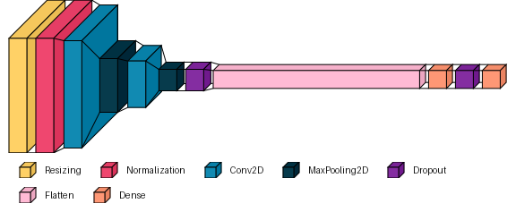
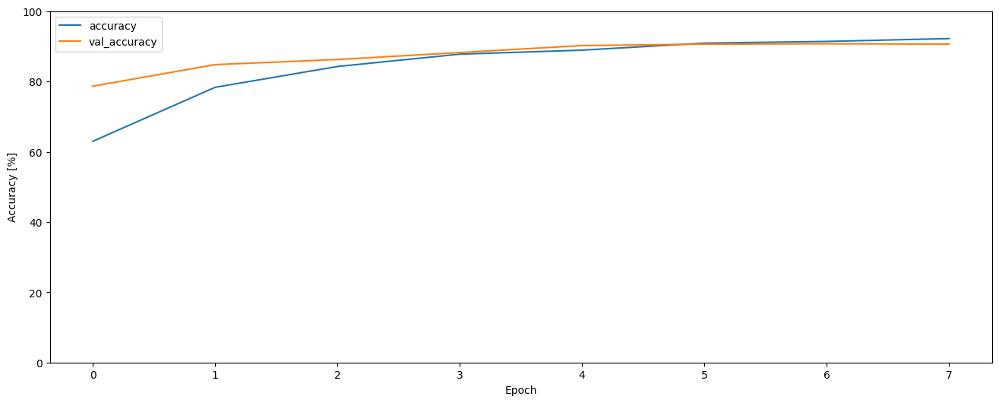

# R.A.M.L.I

**R.A.M.L.I** (**R**ecognition of **A**udio using **M**ulti-**L**ayer **I**ntelligence) is a big project aimed at creating an intelligent assistant for individuals with hearing impairments. It aspires to bridge the communication gap between the hearing and non-hearing communities by leveraging cutting-edge AI to interpret and translate audio into text. This project is initialized by a passionate and caregiving person, as their life motto, “We hear the world, to serve the silence”.

To start the project, the founder gathers some passionate engineers that have the same principle and goal as them. The first task is to make a simple model using CNN Architecture utilizing TensorFlow as the base model for testing purposes. Below is the step to make the model.

1. **Load audio file** dataset from folder **“dataset”.**
2. **Divide the dataset** into **train**, **validation, and test sets** with the ratio of **70/15/15**.
3. **Perform two stages** of **preprocessing** on the **dataset**, which involves **squeezing** and **converting the audio array into a spectrogram** format that can be processed by the Convolutional Neural Network model.
4. Create the following **Convolutional Neural Network** architecture using **TensorFlow** library which the **architecture modeling** is mainly divided into **3 parts**.

    

    *Figure 1. CNN Model Architecture*

- **Input Layers**, defines the **input features** that are obtained from the spectrogram preprocessing result.
- **Hidden Layers**, consists of the **main Convolutional Layer** which applies a set of filters to the input data, which helps to extract relevant features and patterns from the data.
- **Output Layers**, fully connected layer to classify and generate the final output from patterns and features on the data.
5. Train the **Convolutional Neural Network** model using the **train** and **validation set.**

    ```text
    Epoch 1/10
    72/72 [==============================] - 3s 34ms/step - loss: 0.9019 - accuracy: 0.6296 - val_loss: 0.6574 - val_accuracy: 0.7865
    Epoch 2/10
    72/72 [==============================] - 2s 31ms/step - loss: 0.5931 - accuracy: 0.7833 - val_loss: 0.5031 - val_accuracy: 0.8479
    Epoch 3/10
    72/72 [==============================] - 2s 30ms/step - loss: 0.4497 - accuracy: 0.8426 - val_loss: 0.4407 - val_accuracy: 0.8625
    Epoch 4/10
    72/72 [==============================] - 2s 30ms/step - loss: 0.3682 - accuracy: 0.8777 - val_loss: 0.3698 - val_accuracy: 0.8823
    Epoch 5/10
    72/72 [==============================] - 2s 30ms/step - loss: 0.3287 - accuracy: 0.8891 - val_loss: 0.3227 - val_accuracy: 0.9021
    Epoch 6/10
    72/72 [==============================] - 2s 30ms/step - loss: 0.2663 - accuracy: 0.9091 - val_loss: 0.2960 - val_accuracy: 0.9062
    Epoch 7/10
    72/72 [==============================] - 2s 31ms/step - loss: 0.2523 - accuracy: 0.9139 - val_loss: 0.3209 - val_accuracy: 0.9073
    Epoch 8/10
    72/72 [==============================] - 2s 31ms/step - loss: 0.2247 - accuracy: 0.9220 - val_loss: 0.3002 - val_accuracy: 0.9062
    Epoch 8: early stopping
    ```

    *Figure 2. Model Training*

6. Make a **prediction** on a **test dataset** and **display** the **results** with the **highest probability.**

    ```text
    Data 0: Original Label -> tree, Prediction -> tree
    Data 1: Original Label -> learn, Prediction -> learn
    Data 2: Original Label -> tree, Prediction -> tree
    Data 3: Original Label -> tree, Prediction -> tree
    Data 4: Original Label -> tree, Prediction -> tree
    Data 5: Original Label -> visual, Prediction -> visual
    Data 6: Original Label -> tree, Prediction -> tree
    Data 7: Original Label -> visual, Prediction -> visual
    Data 8: Original Label -> learn, Prediction -> learn
    Data 9: Original Label -> visual, Prediction -> visual
    Data 10: Original Label -> visual, Prediction -> visual
    Data 11: Original Label -> follow, Prediction -> follow
    Data 12: Original Label -> learn, Prediction -> learn
    Data 13: Original Label -> tree, Prediction -> tree
    Data 14: Original Label -> tree, Prediction -> tree
    Data 15: Original Label -> visual, Prediction -> visual
    Data 16: Original Label -> tree, Prediction -> tree
    ```

    *Figure 3. Model Prediction*

7. Evaluate the **Convolutional Neural Network** model by **train accuracy** and **validation accuracy**.

    

    *Figure 4. Model Evaluation*
